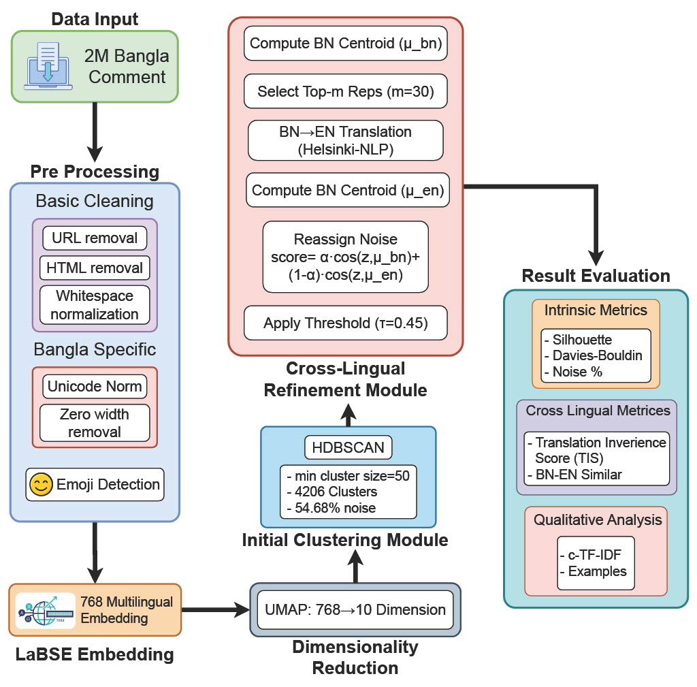

# Cross-Lingual Refinement for Large-Scale Bangla Social Media Comment Clustering

[](https://www.python.org/)
[-orange.svg)](https://huggingface.co/sentence-transformers/LaBSE)
[](#methodology--mathematical-formulation)
[](https://huggingface.co/Helsinki-NLP/opus-mt-bn-en)
[-red.svg)](docs/Project_Document.pdf)

An end-to-end, scalable unsupervised NLP framework for discovering latent topics across **2,008,208 Bangla social media comments**. While density-based clustering (UMAP + HDBSCAN) discovers high-purity semantic cores, it leaves **54.68%** of noisy, code-mixed social media comments unclustered. To overcome this limitation without sacrificing transparency, this project introduces:

1. **Cross-Lingual Translation-Invariant Clustering (CTIC):** An iterative centroid-refinement pipeline that reassigns noise points using a weighted combination of source-language (Bangla) and translated-target (English) cluster centroid similarities—reducing noise to **4.00%** (**96.00%** data coverage).
2. **Translation-Invariance Score (TIS):** A cross-lingual stability metric measuring cosine similarity between Bangla and translated-English centroids ($\text{TIS}_k = \cos(\mu_k^{\text{bn}}, \mu_k^{\text{en}})$) to quantify semantic consistency in label-free multilingual settings.

---

## System Architecture



> **Pipeline Summary:** Raw Bangla comments undergo Bangla-aware Unicode normalization and emoji filtering before being encoded into 768-D L2-normalized vectors via **LaBSE**. **UMAP** projects embeddings into a 10-D manifold for initial **HDBSCAN** density clustering (`4,206` clusters, `54.68%` noise). The **Cross-Lingual Refinement Module** then translates top-30 central representatives per cluster (`Helsinki-NLP/opus-mt-bn-en`), constructs English centroids, and iteratively reassigns noise points exceeding similarity threshold $\tau = 0.45$.

---

## Dataset & Precomputed Artifacts

Due to GitHub's 100 MB file-size limit, the large-scale raw corpora, staged preprocessing files, 768-D LaBSE embeddings, and fitted UMAP models are hosted externally on Google Drive:

* **Google Drive Archive:** [Download Dataset & Embeddings (Google Drive)](https://drive.google.com/drive/folders/1g4I1TVnTETpfMVUEtLMwskhCgsA4gOaI?usp=sharing)

### Dataset

This project uses a **custom, self-curated large-scale Bangla social media dataset** containing over **2 million Bangla Facebook comments** (`2,230,329` raw comments; `2,008,208` embedded after preprocessing)[cite: 40, 45]. The dataset captures authentic social media discourse, including:
* **Bangla & Code-Mixed Text:** Informal Bangla comments, English words, and mixed-script expressions (`Bn`, `Latin`, `Mixed`, `Other`)[cite: 45].
* **Rich Emojis:** Naturally occurring emojis embedded within user comments[cite: 45].
* **Comment Reactions:** Associated user reaction metadata (both Bangla and English reaction labels/counts).

### Download Link & Current Availability

Due to GitHub's 100 MB file-size limit, the dataset is hosted externally on Google Drive:

* **Google Drive Folder:** [Access Dataset on Google Drive](https://drive.google.com/drive/folders/1g4I1TVnTETpfMVUEtLMwskhCgsA4gOaI?usp=sharing)

| File Name | Rows | Size | Status & Description |
| :--- | :---: | :---: | :--- |
| **`balanced_dataset_full.csv`** | 532,687 | 210.5 MB | **Available now** — Stratified reaction/sentiment-balanced Bangla comment subset with emojis and reaction metadata. |
| **Full 2M+ Corpus & Embeddings** (`sample.csv`, `comments_preprocessed.csv`, `embeddings.npy`) | 2,008,208 – 2,230,329[cite: 45] | ~7.4 GB | *Upload in progress* — Full raw comments, cleaned text, and 768-D LaBSE embeddings[cite: 45]. |

---

## Key Findings at a Glance

* **Massive Noise Reduction (`54.68%` $\rightarrow$ `4.00%`):** Iterative cross-lingual refinement reduces unclustered noise points by **92.7%** (from `1,098,208` down to `80,328` comments), boosting overall dataset coverage from **45.32%** to **96.00%** across **3,481 consolidated clusters**.
* **The Coverage–Coherence Tradeoff:** Expanding cluster coverage incorporates broader colloquial expressions and code-switched comments, causing mean TIS to shift from **0.7569** (baseline HDBSCAN) to **0.3380** (refined CTIC)—demonstrating an explicit empirical tradeoff between coverage and cross-lingual semantic tightness.
* **Strong Representative-to-Cluster Correlation ($r = 0.9212$):** Individual comment-level Bangla–English cosine similarity strongly correlates with cluster-level TIS ($r = 0.9212$), proving that translation and multilingual embedding consistency at the sample level directly govern cross-lingual cluster stability.

---

## Methodology & Mathematical Formulation

### 1. Preprocessing & Embedding (`2,230,329` $\rightarrow$ `2,008,208` Comments)
* **Text Cleaning & Normalization:** Removes URLs, HTML tags, extraneous whitespace, and zero-width characters alongside Unicode standardization.
* **Script & Emoji Filtering:** Identifies script composition (`Bn`, `Latin`, `Mixed`, `Other`) and filters emoji-flooded noise comments.
* **Multilingual Representation:** Encodes cleaned comments into 768-dimensional L2-normalized vectors $z_i = f_{\text{LaBSE}}(x_i^n) \in \mathbb{R}^{768}$ using memory-mapped batch inference.

### 2. Manifold Reduction & Initial Density Clustering
* **UMAP Projection:** Fitted on a stratified sample of `250,000` embeddings using cosine distance and applied across all `2,008,208` points ($g_{\text{UMAP}}: \mathbb{R}^{768} \rightarrow \mathbb{R}^{10}$).
* **HDBSCAN Clustering:** Identifies `4,206` variable-density clusters ($\text{min\_cluster\_size} = 50$) while isolating `1,098,208` outlier points (`54.68%`) as noise ($l_i = -1$).

### 3. Cross-Lingual Refinement (CTIC)
For each cluster $C_k$:
1. **Bangla Centroid ($\mu_k^{\text{bn}}$):** Mean-pooled 768-D LaBSE vector of all cluster members.
2. **Representative Translation & English Centroid ($\mu_k^{\text{en}}$):** Top-$m$ ($m=30$) most central Bangla comments are translated to English via `Helsinki-NLP/opus-mt-bn-en` and re-embedded with LaBSE to form $\mu_k^{\text{en}}$.
3. **Weighted Cross-Lingual Reassignment:** Each noise point $z_i$ is scored against all clusters using Bangla weight $\alpha = 0.7$ and English weight $1 - \alpha = 0.3$:
   $$S_{ik} = \alpha \cdot \cos(z_i, \mu_k^{\text{bn}}) + (1 - \alpha) \cdot \cos(z_i, \mu_k^{\text{en}})$$
   Points where $\max_k S_{ik} \ge \tau$ ($\tau = 0.45$) are reassigned to $\arg\max_k S_{ik}$, and centroids are recomputed iteratively until convergence.

### 4. Translation-Invariance Score (TIS)
Cross-lingual semantic stability for cluster $k$ is evaluated in the original 768-D LaBSE space:
$$\text{TIS}_k = \cos(\mu_k^{\text{bn}}, \mu_k^{\text{en}}), \qquad \overline{\text{TIS}} = \frac{1}{K}\sum_{k=1}^{K} \text{TIS}_k$$

---

## Experimental Results & Benchmark Tables

### 1. Clustering Statistics: Baseline HDBSCAN vs. Refined CTIC

| Metric | Baseline (HDBSCAN) | Refined (CTIC) | Relative Change |
| :--- | :---: | :---: | :---: |
| **Total Embedded Comments** | 2,008,208 | 2,008,208 | 0.0% |
| **Active Clusters ($K$)** | 4,206 | 3,481 | -17.3% |
| **Unclustered Noise Points** | 1,098,208 (54.68%) | 80,328 (4.00%) | **-92.7%** |
| **Clustered Comments (Coverage)** | 910,000 (45.32%) | 1,927,880 (96.00%) | **+111.9%** |
| **Minimum Cluster Size** | 50 | 50 | 0.0% |
| **Median Cluster Size** | 87 | 456 | **+424.0%** |
| **Maximum Cluster Size** | 42,501 | 56,842 | +33.7% |

---

### 2. Translation-Invariance Score (TIS) Distribution

| TIS Metric | Baseline (HDBSCAN) | Refined (CTIC) | Relative Change |
| :--- | :---: | :---: | :---: |
| **Mean TIS ($\overline{\text{TIS}}$)** | **0.7569** | 0.3380 | -55.4% |
| **Median TIS** | **0.7642** | 0.3391 | -55.6% |
| **Std. Dev. TIS** | 0.1024 | 0.0946 | -7.6% |
| **High-Coherence Clusters ($\text{TIS} \ge 0.8$)** | **21.3%** | 0.2% | -99.1% |
| **Low-Coherence Clusters ($\text{TIS} \le 0.5$)** | 5.7% | 96.8% | +1598% |

---

### 3. Cross-Model Comparison (HDBSCAN vs. CTIC vs. MiniBatch K-Means)

To benchmark against full-coverage partitioning, CTIC is compared against initial HDBSCAN and spherical MiniBatch K-Means ($K=2000$):

| Clustering Method | Silhouette ($\uparrow$) | Davies-Bouldin ($\downarrow$) | Noise % ($\downarrow$) | Mean TIS ($\uparrow$) | High Stability ($\text{TIS} \ge 0.7$) |
| :--- | :---: | :---: | :---: | :---: | :---: |
| **HDBSCAN (Baseline)** | **0.084** | **1.812** | 54.68% | **0.7569** | **21.3%** |
| **CTIC (Proposed)** | 0.056 | 2.341 | **4.00%** | 0.3380 | 0.2% |
| **K-Means ($K=2000$)** | 0.032 | 3.125 | 0.00% | 0.2810 | 0.0% |

> **Takeaway:** HDBSCAN isolates pure semantic cores but discards over half the dataset. K-Means forces 100% assignment at the expense of severe geometric overlap ($\text{Sil.} = 0.032$, $\text{DB} = 3.125$) and poor cross-lingual stability ($\text{Mean TIS} = 0.2810$). **CTIC** occupies the practical middle ground—capturing **96%** of comments while maintaining superior internal cohesion and cross-lingual alignment over K-Means.

---

## Hyperparameter Configuration

| Pipeline Stage | Key Parameters |
| :--- | :--- |
| **Embedding (LaBSE)** | `dim = 768`, `max_seq_len = 512`, `batch_size = 256`, `L2_norm = True`, `seed = 42` |
| **Dimensionality Reduction (UMAP)** | `n_components = 10`, `n_neighbors = 15`, `min_dist = 0.1`, `metric = cosine`, `fit_sample = 250,000`, `epochs = 500` |
| **Initial Clustering (HDBSCAN)** | `min_cluster_size = 50`, `min_samples = 5`, `metric = euclidean`, `cluster_selection = eom` |
| **Cross-Lingual Refinement (CTIC)** | `NMT = Helsinki-NLP/opus-mt-bn-en`, `reps (m) = 30`, `α = 0.7`, `1 - α = 0.3`, `threshold (τ) = 0.45`, `max_iter = 10` |
| **Evaluation & Interpretation** | `TIS_space = 768D`, `intrinsic_space = 10D UMAP`, `c-TF-IDF = top 10 terms/cluster`, `correlation = Pearson` |

---

## Repository Structure

```text
├── notebooks/
│   └── NLP.ipynb                                # Master 10-stage execution notebook
│
├── results/
│   ├── final_comparison_table.csv               # Main benchmark summary (N, K, Noise %, TIS stats)
│   ├── final_all_metrics_comparison_no_dunn.csv # Intrinsic & cross-lingual validation metrics
│   ├── baseline/
│   │   ├── cluster_sim_tis.csv                  # Per-cluster TIS scores (Baseline HDBSCAN)
│   │   ├── rep_level_similarity.csv             # Representative-level BN-EN similarity pairs (r = 0.9212)
│   │   └── cluster_sizes.npy                    # Point distribution across 4,206 baseline clusters
│   ├── refined/
│   │   ├── cluster_sim_tis_after_correct.csv    # Per-cluster TIS scores after CTIC Iteration 2
│   │   └── cluster_sizes_t2.npy                 # Final cluster size distribution (3,481 clusters)
│   └── kmeans_baseline/
│       ├── cluster_sim_tis_kmeans_k2000.csv     # Per-cluster TIS scores (K-Means K=2000)
│       ├── rep_level_similarity_kmeans_k2000.csv# Representative-level BN-EN similarity (K-Means)
│       └── cluster_sizes_kmeans_k2000.npy       # Point distribution across 2,000 K-Means clusters
│
├── interpretation/
│   ├── cluster_keywords_ctfidf.csv              # Top-10 salient topic keywords per cluster (c-TF-IDF)
│   ├── cluster_examples_bn.csv                  # Qualitative central Bangla examples with cosine distances
│   └── cluster_examples_en.csv                  # Translated English qualitative examples
│
├── tokenizer/
│   └── bangla_tokenizer_quantum.json            # Custom subword/character BPE tokenizer config
│
├── docs/
│   ├── Project_Document.pdf                     # Complete 13-page academic project report
│   └── full_pipeline.jpg                        # High-resolution end-to-end architecture diagram
│
├── .gitignore                                   # Excludes multi-GB embeddings/models while keeping metrics
└── README.md                                    # Project overview, methodology, and benchmark results
```

---

## Reproducibility & Usage

1. **Inspecting Metrics & Discovered Topics Directly:** All evaluation tables (`results/*.csv`), cluster size arrays (`results/**/*.npy`), and `c-TF-IDF` topic keywords (`interpretation/*.csv`) are tracked directly in this repository and can be loaded immediately with `pandas` or `numpy`.
2. **Running the Full Pipeline (`notebooks/NLP.ipynb`):** Multi-gigabyte intermediate files (`embeddings.npy` [5.88 GB], `umap_model.joblib` [2.87 GB], and raw comment CSVs) are excluded via `.gitignore` to comply with GitHub file size limits. To regenerate them from raw comments, run `notebooks/NLP.ipynb` sequentially on a CUDA-enabled GPU environment.
3. **Full Academic Paper:** See [docs/Project_Document.pdf](docs/Project_Document.pdf) for the complete mathematical formulation, literature review, and qualitative discussion.